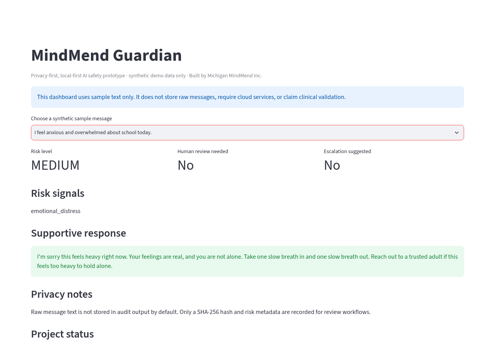
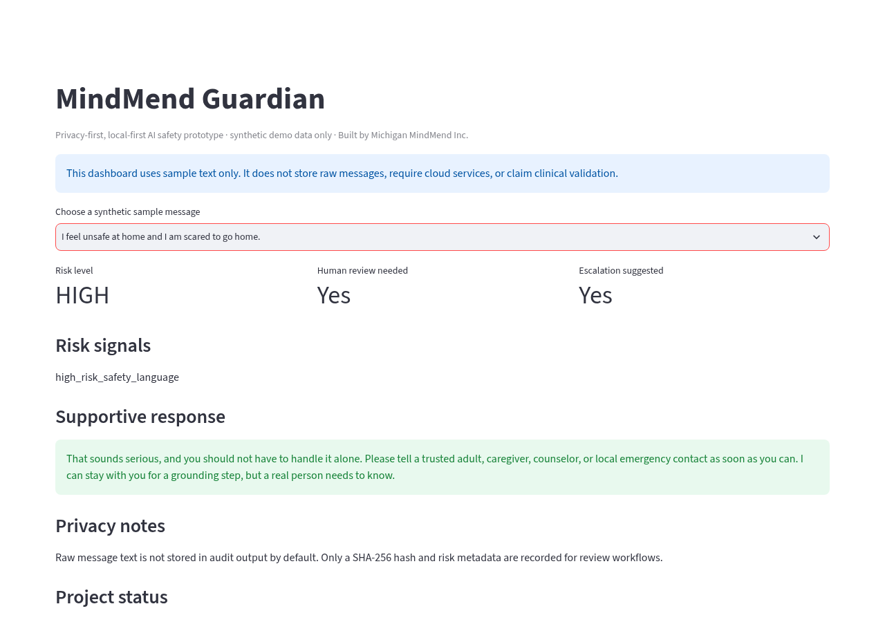
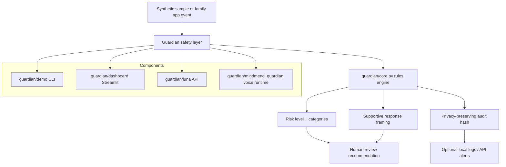

# MindMend Guardian

**Privacy-first, local-first AI safety prototype for youth and family wellness.**

[](pyproject.toml)
[](https://github.com/MiMindMendinc/mindmend-guardian/actions/workflows/ci.yml)
[](LICENSE)

MindMend Guardian is an engineering prototype from **Michigan MindMend Inc.** It demonstrates how families can explore youth safety workflows with risk-signal detection, calm support language, privacy-preserving audit events, and human-in-the-loop review — without default cloud dependency or unsupervised automation. The core rules engine (`guardian/core.py`) has no third-party runtime dependencies, and every demo runs on built-in synthetic samples.

> If someone may be in immediate danger, contact emergency services. In the United States, call or text **988** for the Suicide & Crisis Lifeline.

---

## What this is

- A **local-first safety layer** with import-safe core helpers in `guardian/core.py`
- A **runnable CLI demo** (`python -m guardian.demo`) using synthetic sample text only
- An optional **Streamlit dashboard demo**
- A modular **Luna API backend** for message/location safety checks
- A **voice runtime sketch** for edge deployment experiments (hardware-dependent)
- Documentation for privacy, threat modeling, and responsible use

---

## Visual preview

Real captures of the local Streamlit dashboard (`python -m guardian.dashboard`) running on `127.0.0.1` with the built-in synthetic sample messages only. No real user, child, or family data; no cloud services.

| Medium risk: support only | High risk: human review and escalation |
|---------------------------|----------------------------------------|
|  |  |

CLI demo output (`python -m guardian.demo`, excerpt; full output in [`docs/assets/cli-demo-sample.txt`](docs/assets/cli-demo-sample.txt)):

```text
Sample text: I feel unsafe at home and I am scared to go home.
Risk level: high
Matched signals: high_risk_safety_language
Human review recommended: yes
```

Captured 8 October 2026 from `main` with Streamlit 1.65.0 in headless Chrome (1280×900).

---

## Architecture



See [`docs/ARCHITECTURE.md`](docs/ARCHITECTURE.md) for module boundaries and design notes.

## Repository layout

| Path | What it is |
| --- | --- |
| `guardian/` | The project itself: `core.py` rules engine, `demo/` CLI, `dashboard/` Streamlit demo, `luna/` API, and the `mindmend_guardian.py` voice runtime sketch |
| `tests/` | pytest suite run by CI |
| `docs/` | Architecture, API, security configuration, privacy, threat model, status, roadmap, and screenshots |
| `tools/` | Helper scripts |
| `ani-2027/` | Separate early prototype: a Tauri v2 + React desktop app for local Ollama chat (its own [README](ani-2027/README.md)). Not part of the Guardian safety layer, not covered by this repo's CI, and not yet build-verified per its README |
| `perrien-simulator/` | Early Streamlit/Dash stub that plots an uploaded CSV. Not part of the safety layer; its "Use GPU" checkbox only changes a label, and `app_dash.py` is an unfinished skeleton |
| `models/` | Empty placeholder (`.gitkeep` only); no model files are committed |

## Tech stack

From [`pyproject.toml`](pyproject.toml):

| Part | Stack |
| --- | --- |
| Core rules engine and CLI demo | Python 3.11+, standard library only |
| Dashboard demo (`[simulator]` extra) | Streamlit, pandas, Plotly, NumPy |
| Luna API (`[api]` / `[luna]` extra) | Flask 3, PyJWT, spaCy + spacytextblob, firebase-admin |
| Voice runtime sketch (`[voice]` extra) | ONNX Runtime, PyTorch, PyAudio, pyttsx3 |
| Dev and CI (`[dev]` extra) | pytest + pytest-cov, ruff, pip-audit, GitHub Actions |

---

## Quickstart

```bash
git clone https://github.com/MiMindMendinc/mindmend-guardian.git
cd mindmend-guardian
python3.11 -m venv .venv
source .venv/bin/activate
python -m pip install --upgrade pip
pip install -e ".[dev]"
pytest
```

Full installation guide: [`SETUP.md`](SETUP.md).

## Run the local demo

No cloud services, credentials, or real child data required:

```bash
python -m guardian.demo
```

JSON output:

```bash
python -m guardian.demo --json
```

The demo shows:

- risk level (`low`, `medium`, `high`, `crisis`)
- matched signal categories
- supportive response text
- whether human review is recommended
- a privacy-preserving audit hash (raw text is not stored by default)

## Optional dashboard demo

```bash
pip install -e ".[simulator]"
python -m guardian.dashboard
# or: streamlit run guardian/dashboard/app.py
```

Uses synthetic sample messages only. No Firebase or external APIs required.

## Run tests and lint

```bash
pip install -e ".[dev,api]"
pytest
ruff check guardian tests
ruff format --check guardian tests
```

---

## Privacy and safety principles

- **Local-first by design** — core logic runs without cloud dependency
- **Data minimization** — audit events store hashes, not raw text by default
- **Human-in-the-loop** — AI suggests; trusted adults decide
- **Supportive language** — calm framing instead of fear-based alerts

Details: [`docs/PRIVACY_AND_SAFETY.md`](docs/PRIVACY_AND_SAFETY.md)

## Security model summary

- Secrets and credentials come from environment variables (see [`.env.example`](.env.example))
- Luna API defaults bind to `127.0.0.1` with debug disabled
- JWT auth enabled by default for safety endpoints (`LUNA_REQUIRE_AUTH=true`)
- Request validation on API payloads
- CI runs linting, tests, dependency audit, and secret-pattern checks

Details: [`docs/SECURITY_CONFIG.md`](docs/SECURITY_CONFIG.md) · [`docs/THREAT_MODEL.md`](docs/THREAT_MODEL.md)

---

## Status and limits

**Prototype, v0.3.0.** Detection is rule-based pattern matching, not clinical validation. It is not guaranteed to catch abuse, grooming, bullying, or self-harm; it is not HIPAA/COPPA compliant out of the box; and it is not ready for unsupervised child-safety use or a replacement for parents, guardians, clinicians, or emergency services.

Verified today:

- import-safe core safety helpers with tests
- local CLI demo and optional dashboard demo
- modular Luna API with env-based configuration
- GitHub Actions CI (pytest, ruff, pip-audit, secret scan)

Still evolving:

- voice runtime integration with `guardian/core.py`
- encrypted local logging example
- parent review UI
- edge deployment packaging (Docker / Raspberry Pi)

Details: [`docs/STATUS.md`](docs/STATUS.md)

## Roadmap

See [`docs/ROADMAP.md`](docs/ROADMAP.md). Near-term focus:

- synthetic scenario test expansion
- parent/guardian review workflow mock
- encrypted local audit log example
- deployment notes for edge devices
- short walkthrough video (dashboard screenshots added)

---

## Documentation

| Doc | Purpose |
|-----|---------|
| [`docs/DEMO.md`](docs/DEMO.md) | Demo commands and sample output |
| [`docs/ARCHITECTURE.md`](docs/ARCHITECTURE.md) | Module layout and data flow |
| [`docs/API.md`](docs/API.md) | Luna HTTP API contract |
| [`docs/SECURITY_CONFIG.md`](docs/SECURITY_CONFIG.md) | Environment variables and safe defaults |
| [`docs/PRIVACY_AND_SAFETY.md`](docs/PRIVACY_AND_SAFETY.md) | Privacy and safety principles |
| [`docs/THREAT_MODEL.md`](docs/THREAT_MODEL.md) | Threat model and mitigations |
| [`docs/RELEASE.md`](docs/RELEASE.md) | Versioning and release process |
| [`CHANGELOG.md`](CHANGELOG.md) | Version history |
| [`SETUP.md`](SETUP.md) | Full installation guide |

## Contributing

We welcome thoughtful contributions that respect privacy-first design and
human-in-the-loop safety boundaries.

- Read [`CONTRIBUTING.md`](CONTRIBUTING.md) before opening a PR
- Follow our [`Code of Conduct`](CODE_OF_CONDUCT.md)
- Use [issue templates](https://github.com/MiMindMendinc/mindmend-guardian/issues/new/choose) for bugs and features
- See [`SUPPORT.md`](SUPPORT.md) for help routing

## Responsible disclosure

Report security concerns privately following [`SECURITY.md`](SECURITY.md). Do not open public issues for sensitive vulnerabilities.

---

## Built by

**Lyle Perrien II**  
Founder, **Michigan MindMend Inc.**  
Michigan

Building privacy-first, offline-capable AI safety tools for kids, families, and communities.

## License

Released under the [MIT License](LICENSE).
